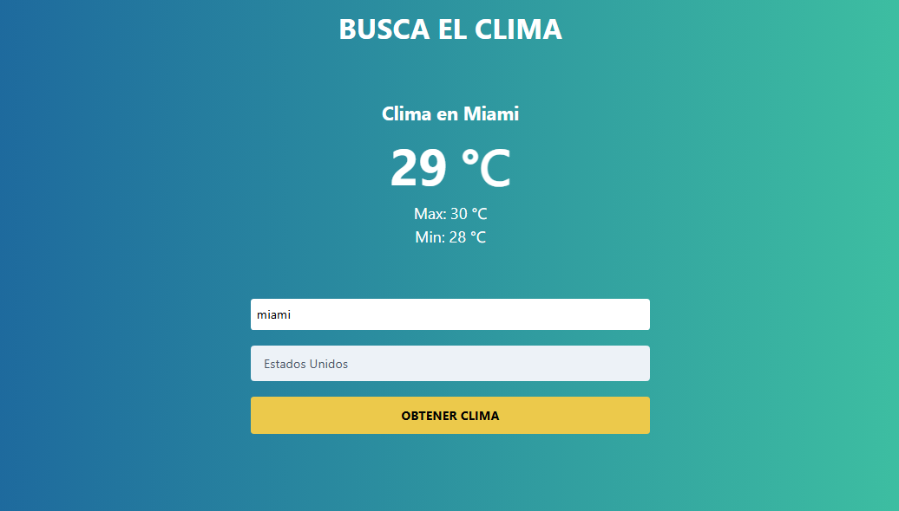

# ☀️ AppClima

<p align="center">
  <strong>El clima de tu ciudad, de un vistazo.</strong><br />
  Consulta la temperatura actual, máxima y mínima con una experiencia sencilla y visual.
</p>

<p align="center">
  
  
  
  
</p>

## 🌦️ Demo

<p align="center">
  
</p>

> La imagen muestra una consulta de ejemplo. Para probar la aplicación, ejecútala localmente siguiendo los pasos de abajo.

## ✨ Funcionalidades

- 🔎 Busca una ciudad y selecciona su país.
- 🌡️ Consulta la temperatura actual, máxima y mínima en grados Celsius.
- ⏳ Muestra un indicador de carga durante la consulta.
- ✅ Valida que se hayan completado la ciudad y el país.
- 🌍 Incluye opciones de países de América y Europa.

## 🧰 Tecnologías

| Tecnología | Uso |
| --- | --- |
| HTML5 | Estructura de la aplicación |
| CSS3 y Tailwind CSS | Estilos e interfaz |
| JavaScript | Validación, solicitudes y actualización de la página |
| OpenWeatherMap API | Geocodificación y datos meteorológicos |

## 🚀 Cómo ejecutarlo

### Requisitos

- Un navegador web moderno.
- Conexión a Internet.
- Una API key de [OpenWeatherMap](https://openweathermap.org/api).
- Node.js y npm para la opción de servidor local.

### Pasos

1. Clona el repositorio y entra en su carpeta:

   ```bash
   git clone <URL_DEL_REPOSITORIO>
   cd AppClima
   ```

2. Configura tu API key de OpenWeatherMap en `js/app.js`.
3. Inicia un servidor local:

   ```bash
   npx serve . -l 8000
   ```

4. Abre [http://localhost:8000](http://localhost:8000) en tu navegador.

También puedes abrir `index.html` directamente, aunque se recomienda utilizar un servidor local.

## 🗺️ Cómo usarlo

1. Escribe el nombre de una ciudad.
2. Selecciona el país correspondiente.
3. Pulsa **Obtener Clima**.
4. Consulta la temperatura actual, máxima y mínima.

## 🔑 API key

La aplicación utiliza la API de OpenWeatherMap para encontrar las coordenadas de la ciudad y consultar sus condiciones meteorológicas. Configura tu propia clave en `js/app.js` antes de usarla.

Como el código JavaScript del navegador es público, no uses una clave privada o sensible ni subas credenciales personales al repositorio. Para un despliegue público, utiliza un backend que proteja la clave y revisa las condiciones de uso del proveedor.

## 📂 Estructura

```text
AppClima/
├── css/
│   ├── styles.css
│   └── tailwind.min.css
├── js/
│   └── app.js
├── clima.PNG
├── index.html
└── README.md
```

## 👨‍💻 Autor

**JEB$DEV — Javier Berchtold**

- [GitHub](https://github.com/JEB76-22)
- [LinkedIn](https://www.linkedin.com/feed/)
- Contacto: [j.e.b.inter@gmail.com](mailto:j.e.b.inter@gmail.com)

---

<p align="center">Hecho con ☀️ y JavaScript</p>
